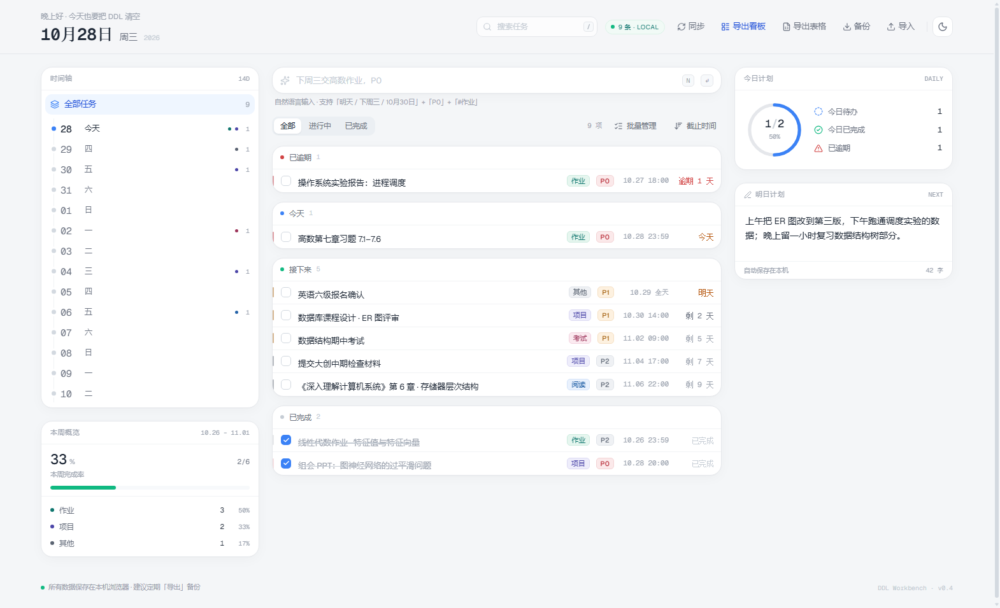
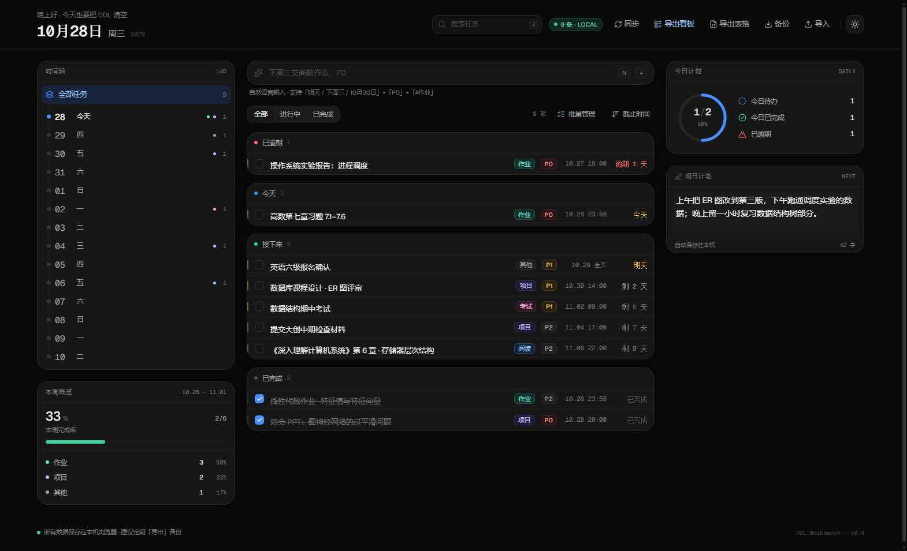

# DDL 工作台

个人 DDL 任务管理工作台 —— 清透莫兰迪浅色主题，纯前端、纯本地。

<p align="center">
  
  
</p>

## 技术栈

React 19 · Vite 8 · TypeScript 7 · Tailwind CSS 4 · shadcn/ui (Radix) · Framer Motion · Lucide

## 启动

```bash
pnpm install
pnpm dev          # http://127.0.0.1:5173
pnpm build        # tsc -b && vite build
```

> Windows 上若 Vite 报 `spawn EPERM`（路径探测调用系统命令被拦），请在普通终端里运行，不要在受限沙箱中运行。

## 已实现

### 布局
顶栏（大号日期） / 左栏「14 天时间轴 + 本周概览」 / 中部「智能输入 + 任务列表」 / 右栏「今日环形进度 + 明日计划」

### 自然语言建任务
回车即解析，识别日期、钟点、优先级、分类。

**默认归属日**：左侧时间轴选中哪一天，没写日期的输入就落到那一天；一旦文本里出现「明天 / 下周三 / 10 月 30 日」等，以文本为准。

### 勾选
Framer Motion 划线动画（从左向右生长）+ 完成态渐隐 + 环形进度与本周完成率联动；勾选后任务归档到「已完成」组。

### 任务详情抽屉
点击任务行任意空白处打开（Esc 关闭），可改：

- 标题、备注
- 分类、优先级
- 截止日期 / 时间 / 全天开关
- 标记完成、删除

改动即时写回本地存储，没有「保存」按钮。

### 手动排序
排序菜单切到「手动排序」→ 列表平铺，整行拖拽调整顺序，顺序写入 `task.order` 并持久化。

### 持久化
任务与 UI 状态（选中日期 / 筛选 / 排序 / 明日计划）写入 localStorage，刷新不丢；写入做 180ms 防抖，失败静默降级为内存态。

### 主题切换（浅色 / 深色）
顶栏最右侧的太阳/月亮按钮切换主题：

- 浅色：`#F4F6F8` 页面 + 白色卡片（当前默认）
- 深色：`#0A0A0A` 页面 + `#171717` 卡片，标签自动切到低饱和暗底 + 提亮文字
- 状态写入 `localStorage` 的 `ddl-workbench.theme`，刷新后保持
- `index.html` 里有一段首屏前置脚本，深色用户不会看到闪烁的白屏
- 切换时给 `<html>` 临时加 `.theme-switching`（320ms），只在这段时间启用全局颜色过渡，避免拖慢日常交互
- 配色全部走 CSS 变量（`src/index.css` 的 `:root` / `.dark` 两套），组件里没有硬编码色值

### 搜索与快捷键
顶栏搜索框按标题实时过滤（与日期、状态筛选叠加），输入时右侧出现清空按钮。

| 快捷键 | 行为 |
| --- | --- |
| `/` | 聚焦搜索框（并选中已有内容） |
| `N` | 聚焦「自然语言新建任务」输入框 |
| `Esc` | 优先关弹窗 → 再关详情抽屉 → 搜索框有焦点时清空并失焦 → 否则清空关键词 |

在输入框 / 文本域里打字时不会触发 `/` 与 `N`；弹窗（含详情抽屉）打开时也不会触发，避免抢键。

### 导出 / 导入备份
顶栏「导出」把全部数据打包成 JSON 下载，文件名 `ddl-backup-YYYYMMDD-HHmm.json`；「导入」读回文件，先弹窗展示「共 N 条任务 / 跳过 M 条无法识别 / 导出时间」，再让你选：

- **合并导入**：保留现有任务，按 `id` 合并；同一条任务取 `updatedAt` 较新的版本。不改动当前的筛选与明日计划。
- **覆盖导入**：清空当前任务，完全按文件恢复（含筛选、排序、明日计划）。

文件结构：

```json
{
  "app": "ddl-workbench",
  "schemaVersion": 1,
  "exportedAt": "2026-10-28T15:07:00.000Z",
  "state": { "version": 1, "tasks": [], "tomorrowPlan": "", "selectedDate": "all", "status": "all", "sortKey": "dueAt", "updatedAt": "..." }
}
```

容错：坏 JSON、缺字段、非法分类/优先级、无法解析的截止时间都不会让导入整体失败——坏记录单独跳过并计数，标题或截止时间缺失的记录直接丢弃。

### 导出看板（HTML，推荐分享）
顶栏「导出看板」生成单文件 `我的任务看板-YYYYMMDD.html`（如 `我的任务看板-20261028.html`）：内嵌 CSS、不引用任何外部资源，双击即可在浏览器打开，也可以直接发给同学或打印成 PDF。

- 内容：标题 + 统计（共 N 条 / 已完成 / 待办 / 生成时间）
- 表格列：任务名称、截止时间（含「剩 N 天 / 逾期 N 天 / 全部」副标题）、优先级、分类、状态
- 已完成行自动置灰 + 删除线
- 时间列等宽字体 + 右对齐宽度自适应，不会出现 WPS 里的 `###`
- 带 `@media print` 与窄屏适配

### 导出表格（CSV，备用）
顶栏「导出表格」导出 `ddl-tasks-YYYYMMDD-HHmm.csv`。

- 文件开头：`\uFEFF`（UTF-8 BOM）+ 第一行 `SEP=,`，让 WPS / Excel 正确识别编码与分隔符
- 列：`任务名称, 截止时间, 优先级, 分类, 完成状态`
- 截止时间 `2026-10-28 23:59`（表格软件会识别为日期，列宽不够时会显示 `###`，双击列边界即可展开）
- CRLF 换行、双引号转义、防公式注入
- 按截止时间升序排列

### 批量管理
任务列表右上角「批量管理」进入：

- 行首复选框替换完成勾选，点整行即可选中
- 顶部条提供「全选 / 取消全选」与「已选 X / N」，只作用于当前筛选可见的任务
- 选中后底部悬浮「删除选中任务 (X)」
- 删除前二次确认；确认后 6 秒内可在提示条撤销
- 「退出批量管理」恢复日常模式（选择清空、拖拽恢复）

## 自然语言语法

| 能力 | 写法 | 说明 |
| --- | --- | --- |
| 日期 | `今天` `明天` `后天` `大后天` | |
| 日期 | `下周三` `周五` `周三` | 无前缀取本周内最近一天 |
| 日期 | `10月30日` `10-30` `3天后` | 跨年自动顺延 |
| 钟点 | `18:00` `下午3点` `晚上8点半` | 不写则按 23:59 视为整天 |
| 优先级 | `P0` `P1` `P2` | 缺省 P2 |
| 分类 | `#作业` `#考试` `#项目` `#阅读` `#其他` | 不写则按关键词推断 |

示例：

```
下周三交高数作业，P0
明天 14:00 组会汇报 #项目 P1
10月30日 数据结构期中考试 #考试
3天后 读完《CSAPP》第 6 章 #阅读
```

## 数据与持久化

- 全部数据存在 `localStorage` 的 `ddl-workbench.v1` 键下，结构见 `src/types/task.ts` 的 `PersistedState`
- 首次进入（键不存在）会注入示例任务；清空任务后不会再次注入
- 重置：DevTools → Application → Local Storage → 删除该键 → 刷新

## 目录结构

```
src/
├─ components/
│  ├─ calendar/date-rail.tsx          14 天时间轴
│  ├─ dashboard/focus-ring.tsx        今日环形进度
│  ├─ dashboard/week-overview.tsx     本周概览
│  ├─ dashboard/tomorrow-plan.tsx     明日计划
│  ├─ layout/top-bar.tsx              顶栏
│  ├─ tasks/quick-add.tsx             自然语言输入
│  ├─ tasks/task-list.tsx             分组 / 手动排序两种列表
│  ├─ tasks/task-item.tsx             任务行（含拖拽变体）
│  ├─ tasks/task-detail-panel.tsx     任务详情抽屉
│  ├─ tasks/task-toolbar.tsx          筛选与排序
│  └─ ui/                             shadcn 组件
├─ data/seed.ts                       示例数据
├─ hooks/use-task-store.ts            状态仓库 + 防抖落盘
├─ lib/
│  ├─ date.ts                         自然日计算
│  ├─ meta.ts                         优先级 / 分类配色
│  ├─ parse-task.ts                   自然语言解析
│  ├─ storage.ts                      localStorage 读写
│  ├─ task.ts                         派生、筛选、排序
│  └─ utils.ts                        cn()
└─ types/task.ts                      领域模型
```

## 尚未实现

- 顶栏「同步」仍是占位（云同步需要后端）
- 自动备份 / 备份提醒（目前导出是手动触发）
- 批量操作目前只支持删除（批量改分类 / 优先级待做）
- 多选、批量操作、子任务、重复任务
- 手动排序只在「手动排序」模式下生效；分组视图使用时间/优先级排序
- 移动端手势与更窄断点的专门排布